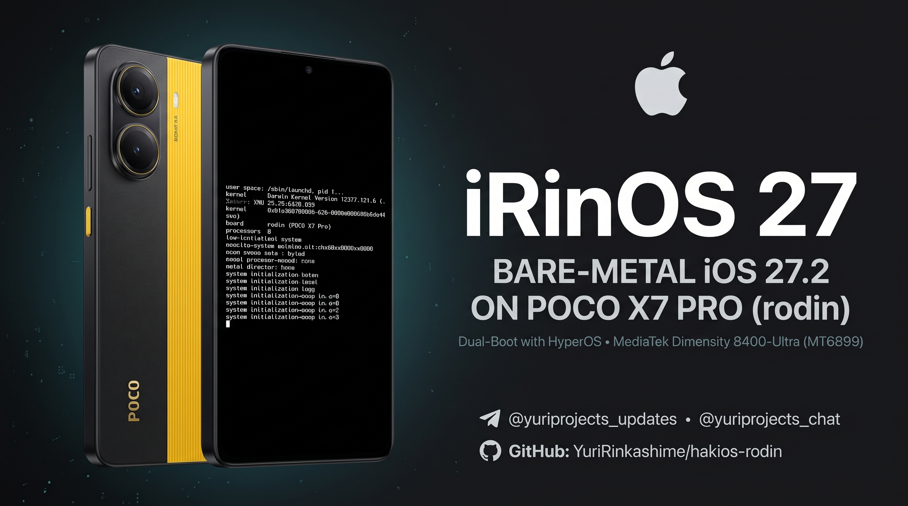

<div align="center">



<br />
<br />

<h1>iRinOS 27</h1>

<p><strong>Bare-metal iOS 27.2 (Darwin 27.2 / XNU 12377.121.6) on the POCO X7 Pro (<code>rodin</code> / MediaTek Dimensity 8400-Ultra)</strong></p>

<p>
  <a href="https://t.me/yuriprojects_updates">
    
  </a>
  <a href="https://t.me/yuriprojects_chat">
    
  </a>
  
  
  
</p>

<p>
  <a href="#hardware-support-matrix">Hardware Matrix</a> ·
  <a href="#boot-chain-architecture">Boot Chain</a> ·
  <a href="#dual-boot-storage-layout">Dual-Boot Layout</a> ·
  <a href="#roadmap">Roadmap</a> ·
  <a href="./BUILDING.md">Build Guide</a> ·
  <a href="https://hakios-developers.com/">HakiOS Registry</a>
</p>

</div>

---

## Overview

**iRinOS 27** is an experimental bare-metal port of Apple's open-source **XNU `12377.121.6`** kernel and **iOS 27.2 (`24B119`)** user space to the **POCO X7 Pro (`rodin` / `MT6899`)**, built on the [HakiOS](https://github.com/oosexgang/hakios-xnu-kernel) architecture.

The port is built for **A/B dual-booting** so your Android daily driver stays intact: **HyperOS** remains untouched on **slot `a`**, while **iRinOS 27** runs independently from **slot `b`** and a dedicated `12 GiB` `darwin` APFS partition on UFS `LUN 2`.

> **Important Notice (Bring Your Own IPSW):**
> This repository contains **zero** Apple copyrighted binaries, IPSWs, decrypted caches, or system images. You must supply or stream-decrypt your own `iPhone12,1` iOS 27.2 (`24B119`) IPSW locally. Carving the `darwin` partition requires shrinking and reformatting Android `userdata` — always back up personal files and critical partitions (`nvram`, `nvdata`, `persist`, `boot_a`, `init_boot_a`, `vbmeta_a`, `lk_a`) before modifying GPT.

---

## Hardware Support Matrix

| Subsystem | Hardware Component (`rodin` / `MT6899`) | Status | Verified Hardware Details |
| --- | --- | --- | --- |
| **Kernel Boot** | Apple XNU `12377.121.6` (`arm64`) | **Working** | Boots bare-metal to `/sbin/launchd` (`PID 1`) with zero set/way cache ops |
| **CPU / SMP** | 8× Arm Cortex-A725 (`MT6899`) | **Working** | All 8 big cores online via PSCI SMP (`cpus=8`, `small_cores_after=0`) |
| **Memory** | LPDDR5X DRAM | **Working** | `5007 MB` mapped cleanly (`0x1c0000000..0x300000000`) |
| **Display** | `1220×2712` OLED Panel | **Working** | `MiniIOMobileFramebuffer` scanout active (software rendering `gpu=0`) |
| **Storage** | Samsung UFS 4.0 (`0x112b0000`) | **Working (RO)** | `DME_LINKSTARTUP` try 1, `fDeviceInit` `0 ms`, `LUN 2` GPT verified, LBA-clamped read-only `/dev/ufs_darwin` driver ready |
| **Buttons** | MediaTek `MT6363` SPMI PMIC | **Working** | `POWER`, `VOL_UP`, and `VOL_DOWN` verified live via `spmi@1cc04000` |
| **Touchscreen** | Goodix Berlin-D `GT9916K` (`spi1@11011800`) | **Working** | `MT6368` `vtp` 1.8V + `GPIO 73` AVDD + `thp-diff` (`18×40`) tracking mapped to `1220×2712`, zero idle ghost touches |
| **iOS 27 `SpringBoard`** | Darwin `27.2` (`24B119`) | **Staged (Phase 6B)** | Offline `system27-prune.apfs` (`4.00 GiB`), `root26-darwin.apfs`, `flashboot.apfs`, PAC-stripped cache, and signed shims built |
| **GPU / Metal** | Arm Mali-G720 MC7 (CSF) | **Planned** | Phase 7 (Mali CSF + Mesa/Viva Metal acceleration) |
| **Wi-Fi / Bluetooth** | MediaTek ConnSys | **Planned** | Phase 7 |
| **Audio / Haptics** | MediaTek Audio / Vibrator | **Planned** | Phase 7 |
| **Battery / Backlight** | `MT6363` Fuel Gauge / Panel BL | **Planned** | Phase 7 |
| **Dual-Boot Selector** | On-device touch boot picker | **Planned** | Phase 7 (currently switched via `fastboot set_active a/b`) |

---

## Boot Chain Architecture

```text
MediaTek Preloader + LK (slot b)
  └─► boot_b (hakios-rodin-boot.img)         — U-Boot + MT6899 board & DRAM bring-up
        └─► init_boot_b (HKUB payload <8MiB) — loader-rodin.efi (PAYLOAD_BASE=0xAC000000)
              └─► XNU 12377.121.6 (XNUP)     — 8× Cortex-A725, 5 GB RAM, UFS RO, MT6363, GT9916K
                    └─► /sbin/launchd (PID 1)
                          ├─► Phase 5 (Bring-Up): RAM-only md0 root (zero storage writes)
                          └─► Phase 6B (iOS 27):  /dev/ufs_darwin (LUN 2 APFS, MNT_RDONLY) → SpringBoard